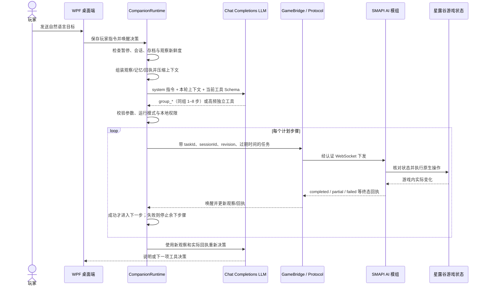

# StardewCompanion

**StardewCompanion 是一个面向《星露谷物语》联机农场的 AI 陪玩与自动劳动项目。** 真人使用原版游戏作为房主，Windows 桌面应用负责对话、调用兼容 OpenAI Chat Completions 的模型并管理本地记忆，SMAPI 模组则以独立联机角色加入房间，在游戏规则内观察和执行操作。

项目仍处于开发和实机验收阶段。部分技能虽然已有代码适配器或模型工具定义，但尚未通过游戏内验证，不应据此视为稳定可用功能。状态、已知问题与验收记录以本文后面的说明和 [实施状态](IMPLEMENTATION_STATUS.md) 为准。

## 目录

- [项目目标与工作方式](#项目目标与工作方式)
- [架构](#架构)
- [一次任务的端到端流程](#一次任务的端到端流程)
- [LLM 视角：上下文、工具与决策边界](#llm-视角上下文工具与决策边界)
- [能力范围与状态](#能力范围与状态)
- [运行环境](#运行环境)
- [玩家快速开始](#玩家快速开始)
- [从源码构建与启动](#从源码构建与启动)
- [检查与实机验收](#检查与实机验收)
- [配置、隐私与安全边界](#配置隐私与安全边界)
- [已知限制与项目状态](#已知限制与项目状态)
- [文档索引](#文档索引)
- [许可与贡献](#许可与贡献)

## 项目目标与工作方式

AI 不是直接读取或改写存档，也不向游戏注入任意脚本。SMAPI 模组观察 AI 客户端当前实际同步到的游戏状态，并通过原版操作、输入和交互完成任务；桌面 Agent 根据玩家目标和观察结果，选择已注册的工具，再由本地执行器逐步验证动作和结果。

模型负责选择**做什么**以及提供技能参数；本地代码负责移动、劳动、权限检查、暂停、动作回执和结果核验。批量区域任务会在本地连续处理并按游戏状态验证，不会为了每一小批格子都重新请求模型。较长工作采用滚动短计划：模型一次提交 1–8 个步骤，每步完成后读取新状态，再决定下一步。玩家的长期目标单独保存，应用重启后 Agent 默认暂停，需玩家点击“继续”。

## 架构

| 项目 | 目标框架 | 职责 |
| --- | --- | --- |
| `src/StardewCompanion.Desktop` | .NET 10 / WPF | 中文桌面界面、聊天、房主与 AI 客户端启动、运行模式和任务控制、设置、工作箱授权及诊断入口。 |
| `src/StardewCompanion.Core` | .NET 10 | Agent 调度、Chat Completions 客户端、工具目录、本机回环服务、权限策略、DPAPI 模型密钥保护、SQLite 记忆、计划与决策记录、上下文管理。 |
| `src/StardewCompanion.Mod` | .NET 6 / SMAPI | AI 游戏角色、观察与回环桥接、原生输入、A* 寻路及地图连接路线、技能执行、动作回执和游戏状态核验。 |
| `src/StardewCompanion.Protocol` | .NET Standard 2.0 | 桌面 Agent 与游戏模组共享的观察、任务、结果和会话协议。 |
| `src/StardewCompanion.Fishing` | .NET 6 | 钓鱼物理、状态模拟与控制器组件；组件存在不代表钓鱼已通过实机验收。 |
| `src/StardewMiningAgent` | .NET 6 | 矿井场景的数据模型、安全监督和规划算法组件；不等同于已开放的自主挖矿技能。 |
| `src/StardewCompanion.Diagnostics` | .NET 10 | 独立运行的本机开发/诊断回环服务。 |
| `tools/` | PowerShell / .NET | SDK 引导、构建、运行、自动检查、预览打包、验证与开发测试辅助脚本。 |

典型运行链路如下：

```text
玩家目标
   ↓
WPF 桌面端 / CompanionRuntime
   ├── Chat Completions API：选择工具与短计划
   ├── SQLite：对话、计划、回执和工作记忆
   └── 本机认证回环服务
            ↕ WebSocket
       SMAPI AI 客户端模组
            ↓
       游戏观察、原生操作、结果核验
```

### 模块边界与数据归属

这里的“Agent”主要指 `StardewCompanion.Core` 中的 `CompanionRuntime` 及其计划、工具调用和上下文组件。WPF 窗口通过它呈现状态并传递玩家操作；核心层持有模型客户端、记忆存储和决策日志。`GameBridge` 在本机回环地址上提供经过会话令牌认证的 HTTP/WebSocket 接口，且同一时刻只接受一个 AI 游戏客户端。SMAPI 模组的 `BridgeClient` 主动连接该服务，收发带会话和消息 ID 的协议包。

可将系统分成三个信任与职责区域：

1. **决策面（桌面 Agent + LLM）**：把玩家要求、当前观察和持久记忆组合成一次决策上下文；LLM 只能从请求中声明的工具中选择。模型返回的计划是意图，不是已经发生的成果。
2. **控制面（Core + Protocol + Bridge）**：验证 JSON/技能参数、运行模式、存档/角色/会话、观察新鲜度和玩家授权；给任务分配 ID 与过期时间，跟踪终态，并在暂停、取消或上下文变化时使旧请求/计划失效。
3. **执行面（SMAPI 模组）**：在游戏更新循环中读取当前游戏对象和网络同步状态，通过原生输入、移动、交互与游戏 API 工作；按原版状态变化形成回执。它不会把 LLM 的自然语言描述当作成功证据。

存储也有明确分工：聊天、工作记忆、计划证据和决策事件保存在本地；API 用量/耗时用于诊断；完整执行证据保留在 SQLite/日志，发送给模型的是按需投影和压缩后的内容。游戏存档仍由游戏本身负责保存，程序重进后需要重新观察并核对，而非把历史回执直接当作当前世界。

## 一次任务的端到端流程

下面以玩家发送“先浇水，再收成熟作物，最后回家睡觉”为例，说明从聊天到游戏动作的实际链路。具体技能是否会被模型选择，仍由当时观察、工具状态和玩家目标决定。



### 流程阶段说明

1. **接收目标**：聊天输入写入本地玩家指令记录和聊天历史，并进入 Agent 队列。新消息会使正在等待的旧模型决策失效；若有活动游戏任务，会请求中断它，然后基于新目标重新规划。
2. **检查可决策条件**：Agent 需要有连接的 AI 客户端、可控的当前会话和新鲜的完整观察。新存档/角色/会话会重置运行状态并默认暂停；换日会让跨日证据需要重核。应用每约 200ms 检查一次调度条件，但模型请求本身是异步的。
3. **准备模型输入**：构造 system 指令和一条结构化 user 上下文，内容包括玩家原始约束、运行模式、当前计划、客户端报告的能力、当前世界快照、近期真实回执、相关记忆、项目和工作箱授权。历史不会无限追加；本地压缩器会去重/投影旧证据，默认主上下文软预算为 32,000 字符（不是 Token 上限）。
4. **请求模型**：桌面端向配置的 Chat Completions 端点发出非流式请求，最多进行有限的工具决策轮次。请求失败不会导致本地擅自执行新任务；Agent 进入等待/退避状态，保留目标并等待后续重试或玩家处理。
5. **解析与计划校验**：工具调用参数必须是合法 JSON 对象。`group_*` 父工具接收同组 1–8 个有序技能步骤；本地递归校验必填项、类型、枚举、范围及子技能归属，并按当前会话防止同一 `planId` 被重复执行。十个高频技能也可独立调用。只说“我会去浇水”不构成工具调用，也不会引发游戏动作。
6. **逐步授权与执行**：Core 对每一步再次检查 Agent 是否已继续、模式是否允许执行、观察是否仍新鲜、当前存档/角色/日期是否相符，并调用 `PermissionPolicy` 检查技能、参数和工作箱授权。命令带唯一任务 ID、会话/存档/角色身份、观察修订号和短过期时间；桥接层不接受无新鲜观察的动作。
7. **游戏内执行和回执**：模组核验任务身份与状态后，在游戏更新循环中执行。状态包括 `completed`、`partial`、`failed`、`cancelled`、`rejected`；回执可包含实际处理格、物品变化、位置、消耗和失败原因。Core 等待终态；随后还会等到新的有效观察修订，再决定下一步，而不是把“已派发”误当完成。
8. **停止或重规划**：短计划按顺序等待真实终态，每步成功且观察刷新后才继续；部分完成或失败会停止剩余步骤。完成一批后，Agent 用更新的观察和回执再次请求模型。暂停、取消、换会话/存档或换日都会终止旧上下文的继续执行。

## LLM 视角：上下文、工具与决策边界

LLM 并不直接看到整个游戏进程，也不会持续“盯着”屏幕。每次调用时，桌面 Agent 将当下可用信息投影为一份结构化上下文；模型只能依据这份快照和本轮工具返回值推理。发生任务结果、观察变化或下一轮调度后，模型才会再次被调用。

### 每轮上下文包含什么

| 上下文部分 | LLM 可见内容 | 解释与边界 |
| --- | --- | --- |
| 当前指令 | 本轮触发原因、玩家原始持久指令与约束 | 原文保留并优先于模型记忆；模型不能自行改写玩家禁令或授权。 |
| 运行状态 | 运行模式、是否暂停、当前会话内的工作计划 | `plan_only` 只准规划；自主模式仍要求玩家显式“继续”。 |
| 当前观察 | 日期/游戏时刻、地图与格子、体力/生命、菜单、世界视图及活动任务等 | 来自当前 AI 客户端可观察范围。未知或未同步内容不是空地，也不是目标已完成。 |
| 能力目录 | 当前客户端上报的技能名、分组、实现/验证状态和原因 | Tool Schema 会按本轮能力过滤；待验收能力会标成 `available_unverified`，不能把它描述成已经通过实机验证。 |
| 候选与查询 | 本地生成的工作候选、此前明确查询结果 | 距离/收益有估算标注；模型可在信息不足时查询，但不要求逐格查询。 |
| 近期反馈 | 去重后的实际任务回执和最近计划结果 | 批次完成只表示该批步骤有终态，不等于长期目标完成。 |
| 记忆/项目 | 与当前存档和 AI 角色相关的玩家约定、地点信息、经验、项目状态和工作箱绑定 | 事实证据与推断/待核验记忆有区分；旧证据跨日后要用新观察核对。 |
| 待答问题 | 之前提出且尚未清除的问题 | 未回答或被移除不代表玩家批准。 |

主上下文由本地 `DecisionContextCompression` 结构化处理，不调用另一个模型来摘要。保留当前观察、用户指令、弹窗和关键真实反馈；压缩旧完成计划、回执、历史索引和部分记忆，较长明细可通过 `read_context_history` 分页读取。默认软预算是 32,000 字符，不包含 system 指令、工具 Schema 和后续工具消息，也不等于 Token 预算。SQLite 中的完整计划、记忆和回执不会因发送摘要而被删除。细节见[上下文管理文档](docs/对话压缩与上下文管理.md)。

### LLM 可以调用什么

工具大致分成四类：

1. **只读观察**：如 `observe`、`inspect_target`、`inspect_targets`、`inspect_route`、`read_context_history`。它们用于获取当前可见游戏事实或本地历史，不应改变世界。
2. **工作计划**：`save_plan` 记录公开目标、依据、假设、成功标准和待办；它只写计划，不执行游戏动作。八类 `group_*` 父工具分别提交同组一至八步短计划；`execute_plan` 不再向模型暴露。`wait_for_change` 在暂时没有适合动作时等待。
3. **游戏技能**：例如 `water_area`、`harvest_area`、`forage_area`、`deposit_items`、`withdraw_items`、`go_to`、`follow_player`、`return_home`、`sleep`；能力过滤会决定某轮的技能 Schema 是否提供给模型。钓鱼、战斗、矿井通行等即使出现在工具定义里，也必须服从当前上报的未验收状态。
4. **记忆/协作**：`ask_user` 提问但不授予权限；`remember_experience` 保存待核验经验；`update_project` 只改下一步建议；`cancel_task` 请求取消。模型不能通过这些工具宣布项目完成或扩大授权。

清障、锄地、播种、通用制作与物品放置作为普通游戏技能开放。已移除模型端的测试专用工具与自动测试箱授权入口；开发检查和隔离运行脚本不属于玩家技能。

### 工具父子层级

父工具中的子技能以当前客户端上报的能力为准；未实现或被禁用的技能不会因分组而获得执行权限。

| 编号 | 类别 | 父工具 |
| --- | --- | --- |
| 01 | 农场经营 | `group_farm_management` |
| 02 | 资源获取与探险 | `group_resources_exploration` |
| 03 | 生产与制作 | `group_production_crafting` |
| 04 | 仓储与经济 | `group_storage_economy` |
| 05 | 导航与移动 | `group_navigation_movement` |
| 06 | 建筑与空间管理 | `group_construction_space` |
| 07 | 社交与世界进度 | `group_social_progress` |
| 08 | 角色维护与日程 | `group_character_schedule` |

另外独立暴露十个高频技能：`go_to`、`water_area`、`harvest_area`、`forage_area`、`sleep`、`clear_area`、`till_area`、`plant_area`、`deposit_items`、`withdraw_items`。查询、计划和记忆工具仍有各自入口。

### 本轮工具调整

| 工具或模块 | 当前行为 |
| --- | --- |
| `go_to` | 合并原 `go_to_and_collect`；`collect` 为布尔值，默认 `false`。可选 `pickupRadius` 为 0–8，默认 2；单个掉落物拾取失败或超时后继续移动，到达时附带采集失败原因。 |
| `water_area` | `autoRefill` 为布尔值，默认 `false`；启用后自动寻找最近可达水源，导航补水后继续原区域任务，跳过已浇水格。模型无需提供补水坐标。 |
| 通用制作与放置 | 以 `craft_items`、`craft_and_place` 替代仅处理箱子的入口；按已解锁配方、明确物品和位置执行。 |
| `plant_trees` | 支持普通树种和果树苗，检查位置、生长空间及季节规则；果树冬季仍可生长，结果季节依树种而定。 |
| `cook_recipes` | 与普通物品制作分开，检查厨房、配方、整批材料和品质条件；不支持的混合品质或自动调味组合返回明确原因。 |
| `upgrade_tool` / `collect_upgraded_tool` | 铁匠铺升级与跨日取回分为两个阶段；检查工具、资金、材料及完成状态。 |
| `care_for_pets` / `manage_livestock` | 宠物抚摸、水盆照料与牲畜购买、出售、迁舍等经营操作分开；每日牲畜照料由 `tend_animals` 承担。 |
| 区域开垦 | `cultivate_plot` 保留已有活作物；锄地跳过已耕格，播种和施肥只处理符合条件的空耕地，按区域已有作物数量计算补种量。清障及清枯作物的镰刀操作增加附近活作物保护。 |
| 工作箱 | 修复空箱被误判为满箱；按实际容量存取并核验数量，嵌套业务操作保留授权绑定，检查结果包含容量和空位。 |
| 原生交互 | 修复机器收取与加料、商店整单预算、建筑结果核验、牲畜与宠物状态、菜单清理及任务领取/交付等路径；不支持的路径明确返回原因。 |
| 模型请求与连接 | 修复工具 Schema 重复必填项；网络异常、HTTP 429 和 5xx 最多尝试三次，HTTP 400 不重试；同端点重启保留有效桥接令牌。 |

上述内容描述代码行为，不代表每条成功路径均已完成实机验收。最近一轮模组、诊断服务和桌面端编译通过；按维护者要求，后续实机与自动检查已暂停，未新建测试存档。

### 模型决定什么，程序决定什么

**模型负责：**

- 理解玩家目标，在当前工具能力和观察范围内选择目标、顺序、参数及是否先查询。
- 比较可见机会、路线、工作收益、资源消耗和时间；依据本轮游戏事实决定继续劳动、恢复、返家或睡觉。
- 选择一批最多八步的短计划，并在每步回执和新观察返回后重新规划。
- 对于没有明确授权、重要不可逆选择或事实不足的情况，提出问题或等待。

**本地程序负责：**

- API 请求、会话身份、工具 Schema、JSON/参数验证、能力过滤和运行模式约束。
- 暂停/取消的即时控制；模型回复若在暂停/换会话后才返回，会被丢弃，不能继续派发旧动作。
- 每个动作发出前重新验证新鲜观察、存档/角色/日期、技能策略和工作箱物品权限。保护物品优先于允许列表，模型无法用参数越权。
- 原生寻路、输入节奏、游戏交互、任务去重/过期、动作中止和游戏状态核验。
- 将已完成、部分完成、失败、拒绝等结果作为回执保存；失败时停止本计划余下动作，避免用模型自述伪造成果。

模型并不拥有隐式的通用游戏控制权限，也不能执行任意 shell、脚本或文件操作。玩家明确指令仍然受游戏能力、权限边界和已验证状态限制；反之，模型提出某项操作也不会自动构成玩家对贵重物品转移、销售、消耗品使用等行为的授权。

### 计划、工具返回和对话的含义

- **模型文本**是说明，不是世界事实。
- **工具调用被接受**表示参数/计划通过对应入口，不表示动作已完成。
- **步骤回执**是执行层报告的结果；还应结合最新观察理解。`partial` 不是完整成功，`blocked`/`rejected` 不代表世界已改变。
- **批次完成**表示这一轮计划的步骤执行结束，不自动结案长期项目，也不证明跨日条件仍成立。
- **历史记忆**用于帮助规划；跨日、重连或世界状态变化后，先用当前观察复核。

诊断窗口会记录上下文压缩指标、模型请求/回复、工具选择、权限通过或拒绝、任务派发和最终回执。它适合复现“LLM 看到了什么、选择了什么、本地为什么批准或拒绝、游戏最后回了什么”，但日志可能包含玩家指令、游戏状态和对话，分享前应脱敏。诊断事件字段见[决策流监控文档](docs/决策流监控.md)。

真人房主从原版 `Stardew Valley.exe` 启动；AI 角色使用 SMAPI 客户端加入该房间。AI 模组通过回环连接本机桌面服务。玩家和 AI 是两个独立的联机角色，真人前台键盘输入不应控制 AI 角色。

## 能力范围与状态

**已经有实机记录的基础能力**包括 AI 独立加入原版房主、角色和存档身份隔离、暂停时停止 AI 输入、正常步行及农场出口切图、浇水与成熟作物收获、已授权工作箱的存取、任务去重和正常上床/换日。详见 [M0 实机证据](docs/M0-EVIDENCE.md) 及 [LLM 自主流程记录](docs/LLM自主流程记录-2026-10-29.md)。这些验证覆盖指定环境和测试存档，并不代表长时间无人值守或所有联机环境均已验收。

当前普通联机陪玩面向的已验证技能范围较窄，主要是农场劳动、地面采集、经授权箱子的物品存取、跟随、步行导航、返家和睡觉。可用能力会受当前游戏状态、位置、材料、工具、权限和模型配置影响；未知区域不能被假定为空。

钓鱼、普通矿井战斗以及经营类技能（制作、动物照料、商店交易、建筑、社区目标等）存在已接入的部分工具或原生适配器，但仍有 `available_unverified` 或待实机验收状态。它们不可仅凭工具定义或代码存在就视为正式支持。`mine_travel` 仍被禁用；骷髅洞穴、火山矿洞及沙漠交通不在支持范围。清障、锄地和播种已使用通用区域执行器，不再依赖单人开荒专用执行器。

以运行时能力状态、[实施状态](IMPLEMENTATION_STATUS.md) 和对应实机记录为准；若文档与程序报告的能力状态不一致，应按更保守的状态处理。

## 运行环境

目前的验证基线：

- Windows 10/11 x64。
- Stardew Valley 1.6.15。
- SMAPI 4.5.2，供 AI 客户端使用；真人房主保持纯原版客户端。
- .NET SDK 10.0.403。仓库 `global.json` 固定此 SDK，并允许滚动至兼容补丁版本。
- 玩家可访问的 OpenAI 兼容 Chat Completions API 及有效模型配置。
- 同一农场的房主与 AI 客户端必须能通过游戏支持的联机网络互相连接；首次创建/加入房间需要在游戏界面操作。

桌面预览包采用 Windows x64 自包含发布，附带 .NET 运行时；《星露谷物语》和 SMAPI 仍需玩家自行安装。源码构建模组需要本机游戏目录中的游戏与 SMAPI 程序集。

## 玩家快速开始

优先参考完整的[玩家快速开始指南](docs/玩家快速开始.md)。简要流程如下：

1. 安装兼容版本的《星露谷物语》和 SMAPI。建立真人房间的客户端必须通过原版 `Stardew Valley.exe` 启动，不要把本项目桥接模组安装到真人房主。
2. 下载并解压项目提供的 Windows x64 预览包。将包内 `Mods/StardewCompanion.Bridge` 复制到游戏的 SMAPI `Mods` 目录。
3. 启动 Companion，在“设置与工作箱”填写模型 API 地址、模型名称、密钥和游戏目录。密钥由当前 Windows 用户的 DPAPI 加密保存；切换 Windows 账户后需要重新填写。
4. 在游戏中创建或打开真人房主农场。回到 Companion，使用“打开 AI 客户端”启动 SMAPI 游戏实例。
5. 在 AI 客户端中选择“合作”并加入真人房主。首次创建 AI 农场角色时按游戏提示手动完成。
6. 回到 Companion，确认当前存档和 AI 角色身份，点击“继续”，再用聊天输入框发送目标。也可以打开诊断窗口观察决策、计划和执行回执。

应用启动或重新加入游戏后 Agent 默认暂停。暂停会停止后续派发并向模组发送停止信号，但不会暂停联机世界本身。模型配置缺失或请求失败时，不会授权新的模型任务。

### 工作箱授权

先让 AI 角色进入箱子所在地图，再到“设置与工作箱”绑定箱子名称及当前格子，并明确填写允许物品 ID 和保护物品 ID。保护列表优先于允许列表，工具默认不会转移。箱子搬迁或替换后旧坐标绑定会失效，需重新绑定。不要授权不希望 AI 搬动的贵重物品。

### 控制与持久化

- **暂停/继续**：暂停本机 Agent 执行；继续后才会处理排队目标。游戏世界继续正常运行。
- **取消工作**：停止当前工作并将相应长期项目标记取消；不会自动恢复，需玩家重新创建目标。
- **仅规划/自主执行**：仅规划模式只生成或修订计划；自主执行模式可在玩家继续授权后调用游戏技能。
- **记忆与回执**：本地 SQLite 按存档和 AI 角色隔离。历史证据不能替代重进游戏后的新观察。
- **换日/重连**：世界可能发生变化；重新加入后应先核对观察、角色和存档状态。未完成的旧日步骤不会被当作新一天已完成。

## 从源码构建与启动

在仓库根目录打开 PowerShell。先引导仓库使用的本地 .NET SDK，再构建项目并启动桌面端：

```powershell
powershell -NoProfile -ExecutionPolicy Bypass -File tools/bootstrap.ps1

powershell -NoProfile -ExecutionPolicy Bypass -File tools/build.ps1 `
  -GamePath 'F:\SteamLibrary\steamapps\common\Stardew Valley'

powershell -NoProfile -ExecutionPolicy Bypass -File tools/start-desktop.ps1
```

将示例路径替换为本机游戏安装目录。`GamePath` 必须包含 `Stardew Valley.dll`、`StardewModdingAPI.dll` 等构建引用。`tools/build.ps1` 会构建模组、诊断服务和桌面项目，并将模组文件暂存到忽略目录 `.local/ai-mods/StardewCompanion.Bridge`。游戏运行前仍需按实际启动脚本/指南配置该模组。

相关开发入口：

```powershell
# 启动桌面 Agent
powershell -NoProfile -ExecutionPolicy Bypass -File tools/start-desktop.ps1

# 独立诊断服务
powershell -NoProfile -ExecutionPolicy Bypass -File tools/start-agent.ps1
```

若只需构建 Windows x64 自包含桌面发布目录、生成校验信息和预览 ZIP，可运行：

```powershell
powershell -NoProfile -ExecutionPolicy Bypass -File tools/publish-windows.ps1 `
  -GamePath 'F:\SteamLibrary\steamapps\common\Stardew Valley'
```

`tools/publish-windows.ps1` 面向发布维护者：先运行统一自动检查，再输出到 `artifacts/StardewCompanion-preview-windows-x64.zip`，并进行包哈希及启动验证。该预览包不代表所有游戏技能和发布门槛均已通过。开发工具输出位于 `.local/`，默认不纳入 Git。

## 检查与实机验收

未安装游戏的贡献者可先运行核心与工具检查。需要 Windows 和 `global.json` 对应的 .NET SDK；脚本优先使用 `.tools/dotnet/dotnet.exe`，否则使用 PATH 中的 `dotnet`：

```powershell
powershell -NoProfile -ExecutionPolicy Bypass -File tools/run-core-checks.ps1
```

该入口构建并运行工具契约、Agent/权限/记忆、上下文、短计划、事件反馈、季节工具和算法回归。模型与游戏桥接使用本地替身，不需要游戏程序集、真实 API 密钥或固定诊断端口。工具契约报告保存在 `.local/checks/tool-contracts.json`；报告中的工具数量不代表实机验收数量。GitHub Actions 在 Windows 上运行同一入口，并额外编译桌面端和诊断服务。

统一构建与自动检查命令：

```powershell
powershell -NoProfile -ExecutionPolicy Bypass -File tools/run-checks.ps1 `
  -GamePath 'F:\SteamLibrary\steamapps\common\Stardew Valley'
```

该脚本会构建完整解决方案，运行桥接、输入/寻路检查，再调用上述核心与工具检查入口。执行前需要退出正在运行的 SMAPI AI 客户端，并释放本机诊断端口 `27841`。完整检查需要本地 SDK 和游戏程序集；自动化通过不能替代游戏内联机验证。

可选的真实 API 连通检查会发出一次真实模型请求，需已配置 API 密钥：

```powershell
dotnet run --project tools/CoreChecks -c Release -- D:\code\sw --live
```

这项请求用于验证 API 连通，不意味着已测试所有模型能力、长期运行稳定性或实际收费/Token 表现。上下文离线重放结果、实机观察记录及其测试边界分别见 [上下文管理文档](docs/对话压缩与上下文管理.md) 与 [实施状态](IMPLEMENTATION_STATUS.md)。

## 配置、隐私与安全边界

- 模型 API 地址应为可信服务的 HTTPS Chat Completions 端点；桌面端使用 Bearer 认证。不要将密钥提交到仓库或粘贴到日志/公开截图中。
- API 密钥使用当前 Windows 用户 DPAPI 加密；模型配置、聊天、任务日志和工作记忆保存在本机应用数据中。模型请求会将完成任务所需的对话和当前观察发送给配置的模型服务，请按该服务的隐私条款选择数据。
- 桌面 Agent 与模组通过本机回环服务通信，服务使用本地会话令牌。工具由本地目录限定；模型不会直接获得任意命令行、代码执行或文件系统工具。
- 游戏动作受当前观察、技能实现、存档/角色身份、游戏规则和本地权限共同约束。工作箱物品范围由玩家显式配置；模型回答或计划本身不构成额外授权。
- 玩家指令、暂停/取消状态和记忆在本地保存。不要把开发测试夹具放进玩家发布包，也不要在普通联机存档启用单人测试工具。
- 升级前正常退出 Companion 与 AI 客户端，并备份本地 Companion 数据和自己的游戏存档。维护/卸载细节见[快速开始指南](docs/玩家快速开始.md)。

## 已知限制与项目状态

- `complete_public_project` 尚缺各项目专用预算与提交适配器，当前不作为可用能力提供；部分活动小游戏及非物品递送类任务仍未完成适配。
- 料理、畜牧、工具升级、建筑及献祭等中后期成功路径尚未完成本轮实机验收；不能将编译通过或工具注册视为全部功能通过。
- `tools/ToolChecks` 已接入解决方案、统一检查与无需游戏的检查入口，覆盖工具目录、八类分组、十个高频入口和参数契约；短计划及事件反馈回归使用当前 `group_*` 接口。实机能力仍须按原生回执逐项验收。
- 项目尚未达到完整正式发布验收。当前通过的自动检查和指定存档实测，不证明所有版本组合、网络环境或长期无人干预任务都可靠。
- 2026-10-29 的一轮真实 LLM 农务、采集、归仓和睡觉流程中曾因观察缺少作物死亡状态而暂停、修复并重连后继续；这是人工介入后的试运行。
- 此前联机换日曾停在原版同步屏障等待。之后有成功换日记录，但旧问题根因仍未确认，不能据此断言已彻底解决。
- 连续多日无人干预、长期项目跨日核对、Vanilla 房间中其他真人加入、完整安装，以及经营工具的分批原生验收仍需继续验证。
- 计划、上下文压缩和离线检查结果见对应文档；字符压缩数据不是实际 Token 或费用数据。

请在正式存档前备份存档，并优先使用专门测试农场验证。完整状态和最近更新见 [IMPLEMENTATION_STATUS.md](IMPLEMENTATION_STATUS.md)。

## 文档索引

| 文档 | 内容 |
| --- | --- |
| [玩家快速开始](docs/玩家快速开始.md) | 安装、加入房间、设置工作箱、控制和维护。 |
| [实施状态](IMPLEMENTATION_STATUS.md) | 项目模块、已验证能力、当前风险和待验收门槛。 |
| [计划与里程碑](PLAN.md) | 项目计划和阶段目标。 |
| [短计划与滚动贪心](docs/短计划与滚动贪心.md) | 模型短计划、本地执行顺序和自主决策行为。 |
| [对话压缩与上下文管理](docs/对话压缩与上下文管理.md) | 上下文构成、历史分页查询、压缩策略和离线数据。 |
| [决策流监控](docs/决策流监控.md) | 查看模型决策、权限判断、任务计划和回执。 |
| [M0 实机证据](docs/M0-EVIDENCE.md) | 基础联机与游戏内能力验收记录。 |
| [单人五日开荒测试](docs/单人五日开荒测试.md) / [十日自主测试](docs/十日自主测试.md) | 隔离开发测试场景与运行方式；不代表普通联机技能已开放。 |
| [近期实机记录](docs/LLM自主流程记录-2026-10-29.md) | 真实模型试运行过程及人工介入情况。 |
| [三日运行日志修复记录](docs/三日日志问题修复记录-2026-10-30.md) / [日志分析](docs/三日新档日志分析-2026-10-30.md) | 最近测试运行中的问题与分析。 |

## 许可与贡献

当前仓库未见根目录许可证文件。再分发、商业使用或提交贡献前，请先与项目维护者确认适用的许可与贡献流程。报告问题时建议附上游戏/SMAPI/.NET 版本、存档与角色是否为测试专用、复现步骤，以及脱敏后的相关日志；不要附 API 密钥或真实存档隐私数据。
