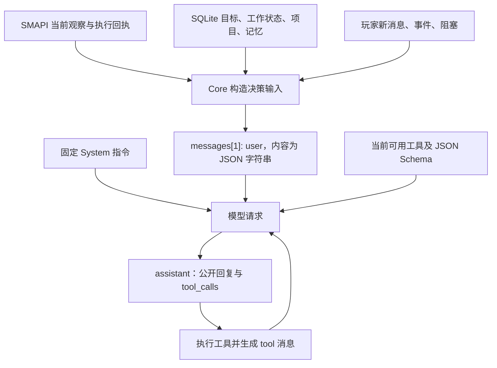

# 修复后：LLM 实际看到的内容架构

日期：2026-11-07。对应本次源码修改；不是 11 月 4 日报告中的旧版 `Build(source)` 管线。

## 1. 模型请求的外层结构



日常决策请求包含：

```text
model
stream = false
max_tokens = 2400
messages
  [0] system：DecisionInstructions.System
  [1] user：BuildDecisionInput 生成的 JSON，序列化为字符串
  [2...] assistant/tool：仅本次 Think 的调用与返回
tools：DecisionTools 生成的实际工具 Schema
tool_choice = auto
```

模型每次新的 Think 都收到重新构造的输入；日常路径不会自动附上完整聊天、完整计划档案或上一次 Think 的全部消息。玩家待交付消息、工作状态、近期结果与历史检索共同提供连续性。System Prompt 本次没有扩写。

## 2. 日常输入的十个顶层部分

| 字段 | 内容及来源 | 作用与边界 |
|---|---|---|
| `trigger` | kind、gameDay、reason | 说明此次为何决策，例如新消息、换日、任务终态、无动作重试 |
| `playerGoal` | 原文目标、完成条件、优先事项、限制、自主范围、禁用技能、版本和状态 | 玩家目标是边界，不以模型建议替代玩家授权 |
| `conversation` | newMessages、unansweredQuestions | 传递尚未确认交付的玩家消息及待回答问题 |
| `agentState` | 当前目标、依据、待办、已核验里程碑、历史里程碑、阻塞、最近回执、季节计划 | 延续工作；历史记录与当前核验明确区分 |
| `world` | 当前观察的世界投影，以及程序预计算摘要 | 主要事实来源；未知值保留为 null/unknown |
| `recentEvents` | 待交付游戏事件及新增动作结果提示 | 防止重要变化被忽略，详细结果引用 lastAction |
| `activeProjects` | 活跃项目的结构化摘要 | 恢复中长期项目的默认可见性 |
| `candidateActions` | 当前可见耕地、作物和采集物产生的候选 | 建议列表，不替模型执行，也不代表路线已经可达 |
| `relevantMemories` | project、agreement、routine | 三类分别选取，避免项目挤掉经验；保留类型和可信状态 |
| `decisionScope` | 本轮可用技能、查询、工具及检索入口 | 与实际请求的 tools 一起约束合法调用 |

### agentState

```text
currentObjective / objectiveBasis / objectiveKnowledge
next / activePlanId / goalVersion / session
mode / running / phase
confirmedMilestones         当前会话真实执行结果，最多16项
historicalMilestones        旧会话结果，最多16项，historical_requires_recheck
blocked                    程序记录的失败原因、目标、次数及证据
lastAction                 最近单次结果或批次汇总
seasonPlan                 已有季节计划；未创建时可能没有该字段
```

换日保留 currentObjective 和 objectiveBasis，只退休旧批次的 next/activePlanId。新会话保留目标，将旧 confirmedMilestones 移入历史并标为待复核。玩家明确替换目标仍会退休旧目标；桌面编辑页可取消“替换当前工作目标”，用于仅补充说明。两种更新都会停止旧批次、清除待执行步骤，避免继续执行与新约束冲突的动作。

### world

```text
observationRevision / gameDay / time / location / tile
stamina / health / maxStamina / maxHealth / money / rain
calendar / menu / menuContext / mailbox
inventoryState / inventoryRelevant
authorizedChests / authorizedChestCount
farm / starterGift
soil / forage / looseDrops / naturalObstacles / routes / home / water
npcs / chests / animals / pets / buildings / toolUpgrade / knownRecipes
queryFacts
fishing / combat              对应技能在范围内时提供
risks
  nativeForcedPassOutTime / gameMinutesUntil2AM
  staminaUntilNativePassOut / consequences
  activeConstraints          从原生失败收据投影出的明确限制
farmingPlan
  location / observedRevision / scope
  harvestableCount / waterableCount / emptyPlotCount
  availableSeedCount / seedCoverageRatio / seedCoverageMeaning
  nearbyRefillTiles / nearbyRefillSourceObserved / refillMeaning
```

耕地明细最多提供距离最近的64格，其他世界数组通常最多24项，并给出 total/truncated。farmingPlan 对截断前的当前地图观察计算，因此“列表只展示64格”不会使总量计算也只算64格。跨地图农场摘要不伪装成当前地图逐格观察。

种子数量使用原生背包新增的 isSeed 标记。旧桥接端没有标记时返回未知，不猜测物品 ID。覆盖率只是“种子类别物品数 / 当前空耕地数”，不是季节适用性、种植成功率或面积承诺；无空地时比值为 null。附近补水点由原生地图查询给出，限定曼哈顿距离5格，仍需执行器验证可达性。程序不以固定时间阈值强制替模型决定睡觉。

activeConstraints 包含 `shop_closed_for_day`、`inventory_capacity_blocked` 等原生失败约束，附技能、位置、目标、blockedDay 和解除条件。它们是带来源的失败事实，不意味着程序知道所有商店的实时营业状态。

### activeProjects 与 relevantMemories

项目结构为：

```text
id / goal / nextStep / status / remaining
lastCheckedSession / knowledge
verifiedResults              最近4条结构化原生结果
verifiedResultCount / unverifiedResultCount
historyReference             按项目ID查询完整原文和分页结果
```

项目来自当前 scope 的 MemoryStore.Projects；已取消、无效、玩家确认完成的项目不投影。项目列表沿用存储层最近500条记忆的工作窗口，完整旧记录仍可分页查询。旧的非结构化项目文本保留在 relevantMemories/历史查询中，不强行解释成 ProjectNote。

relevantMemories 按三类分别选取最多4条，共最多12条，按目标词匹配排序。agreement 保持原文，routine 解码为经验内容，project 提供标题及查询引用；项目的结构化详情位于 activeProjects，避免重复传送长收据。

32,000字符是日常 JSON 的软预算。超出时先移除非 agreement 的相关记忆；玩家目标、已选约定、项目摘要、观察与重要反馈不因预算被强行截断，超额会记录到 input_projection。此预算不等同于请求总 token 限制，工具 Schema 另计。

## 3. 候选行动与工具的关系

GreedyCandidates 已接入活跃输入：浇水优先级1、收获2、采集3，同级按曼哈顿距离排序，最多24个。支持当前地图的可见数据，不只 Farm。投影时排除本轮禁止的技能。候选不含臆测的利润或未观察到的远程目标，也不会自动推荐未经授权的箱子操作。

八个组合工具为：

| 工具 | 工作域 |
|---|---|
| group_farm_management | 农场经营 |
| group_resources_exploration | 资源与探险 |
| group_production_crafting | 生产制作 |
| group_storage_economy | 仓储经济 |
| group_navigation_movement | 导航移动 |
| group_construction_space | 建筑空间 |
| group_social_progress | 社交进度 |
| group_character_schedule | 角色日程 |

每个组合工具包含本组子技能的参数 Schema，模型提交 planId、steps，及可选 encounterPolicy。动作子步骤只能来自同一组。常用动作还可直接调用；查询、save_plan、wait_for_change 等单独提供。组合范围受原生能力状态、矿洞禁用、玩家禁用技能、箱子授权约束，不按目标关键词收窄。list_capabilities 可展开额外顶层工具。execute_plan 不再保留不可达的派发分支。

## 4. 工具往返、季节维护与离线聊天

同一个 Think 最多进行3轮模型调用。assistant 的工具调用与 tool 的实际返回进入后续轮次。observe 成功时更新 user 中的当前世界快照，工具回复仅返回“已更新观察”的引用，避免重复整份观察。

季节维护走独立请求：System 使用 SeasonMaintenance；user 包含 instruction、playerGoal、observation 的日期/日历、seasonPlan、seasonMaintenance。工具仅提供 create_season_plan/update_season_progress，不提供游戏动作。维护完成后唤醒日常决策。

断开游戏时走 OfflineChat：依据玩家目标、工作进度、项目/约定/经验、最后已知观察和聊天记录回答，模型没有游戏工具。过期快照不当作实时观察。

## 5. 可核验交付

交付包内 `samples/llm-request.fixture.json` 是修复后代码发送给本地假模型的实际 HTTP 请求体，包含完整 System、十部分输入和工具 Schema；`samples/llm-context.fixture.json` 是其中解码后的 user JSON。样本为自动回归夹具，非实机自主游玩日志，不含密钥。

源码入口：DecisionInput.cs、DecisionProjections.cs、GreedyCandidates.cs、ModelClient.cs、DecisionInstructions.cs、ContextHistory.cs。当前运行时使用 BuildDecisionInput + Serialize；上下文辅助类仅保留现用的序列化、查询和回执投影功能。
