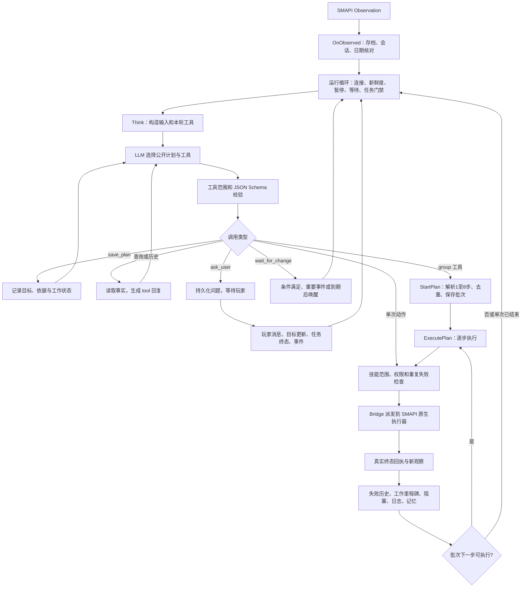
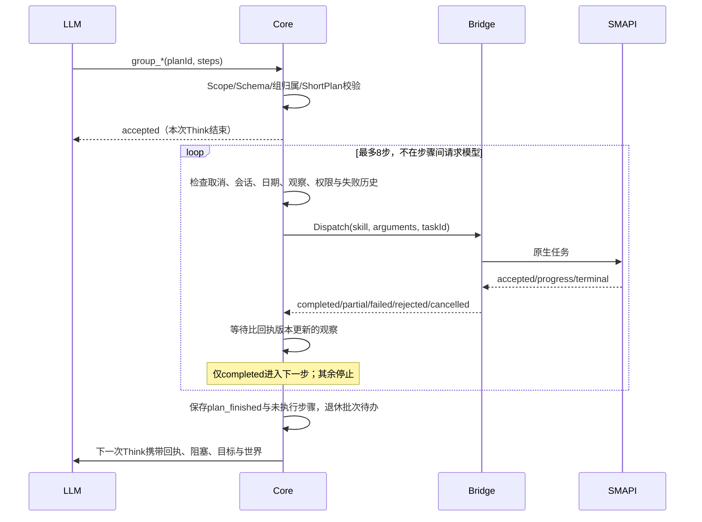

# 修复后：整体 Plan-Execute 循环架构

日期：2026-11-07。架构为“模型选择策略、Core 管理循环、SMAPI 原生执行、回执核验反馈”，不使用额外大型 Agent 框架。

## 1. 总体闭环



这里的 plan 有两个层次：save_plan 记录公开目标与依据；group_* 提交短批次的明确操作。保存文字计划不代表已经执行，accepted 也不代表执行完成。

## 2. 触发与调度

OnObserved 只接收允许控制的角色观察，以 `SaveId:PlayerId` 隔离持久状态，并核对 SessionId。首次连接或会话切换默认暂停，玩家继续后才执行。

Run 大约每200ms检查一次：连接是否正常、观察是否新鲜、世界是否就绪、模型是否忙碌、批次是否运行、原生存档/睡眠菜单是否阻塞、重试时间是否到期。自主决策还要求没有活动原生任务、没有待答问题、所需观察版本已到达。

原版剧情/提示先由 SMAPI 本地脚本捕获。无选项的通知由脚本按原生对话点击流程确认，并记录完整文本；有选项的对话只记录正文与 responseKey，脚本不猜选。未读信件由脚本从原版 `Data/mail` 只读提取正文模板与附件指令，不打开界面、不标记已读、不领取附件。若提示期间有活动任务，事件记录 `activeTaskId`，必要时另带 `blockedTaskId`；Core 暂缓该事件的唤醒。任务终态回执写入后再唤醒模型，使 `recentEvents` 与 `agentState.lastAction` 在同一轮输入中交付。没有活动任务时，事件入账后直接唤醒模型。

WakeDecision 合并触发请求并设置约200ms的决策到期时间。触发包括玩家消息、任务终态、重要事件、等待条件变化、等待到期、无动作重试以及季节维护结束。重要事件在活动任务期间只持久化，不单独唤醒；任务结果和 action feedback 完整记录后，OnResult 再触发下一轮。

断线会暂停；观察过期时等待新观察。玩家暂停、目标更新、取消、会话改变使用 epoch/cancellation 使旧模型回复失效，过期回复不能继续派发动作。

## 3. Think 的有界工具循环

```text
构造 System + user JSON + tools
for round = 0..2:
    调用模型
    再核对 epoch / scope / session
    确认此次玩家消息与事件已交付
    保存公开文本与 tool_calls
    对每个调用:
        校验 JSON、tool_in_scope、参数 Schema
        执行查询/保存计划，返回结果供继续推理
        或接受一个批次/单次动作/等待/提问
        一旦发生上述控制性动作，停止处理本回复后续调用
    若已接受动作：结束本次 Think，等待真实结果
    否则继续下一轮；最多3轮
```

非法参数和重复失败以 rejected tool 结果反馈，模型可以在剩余轮次修正。纯文本回复不代表已操作游戏；未选择行动时按5、10、20、40、60秒进行有上限退避。模型服务不可用或请求超时会安排重试，正在进行的本地任务不因此被当作成功。

查询/历史调用不计为游戏动作。save_plan 后可以在同一回复继续选择 group_*。一旦已经提问、等待或派发游戏任务，就不再执行该回复中排在后面的控制性调用。

## 4. 批次执行



StartPlan 的关键规则：planId为1至100字符；1至8步；每步参数必须满足原始技能 Schema；组工具不接收 goal/basis 等计划说明字段。缺省目标从当前工作目标、玩家目标补齐。睡觉和持续跟随必须放在最后一步。相同计划ID在相同事实状态下不重复派发。

ExecutePlan 每步重新核对运行状态、scope/session/day、观察新鲜度和控制策略，再做技能权限及失败历史检查。ShortPlanExecutor 先监听结果再派发，按 taskId 接收真实终态，随后要求观察版本比回执版本更新。普通技能终态等待180秒，钓鱼/战斗/矿洞类900秒，持续跟随等待取消。矿洞仍受当前禁用策略约束。

partial 不算整步完成，立即停止后续步骤。取消、超时或上下文变化也停止；finally 保存批次结果、原始失败原因及未执行步骤，然后唤醒下一轮。单次动作则在派发后结束 Think，由 OnResult 在终态时唤醒下一轮。

## 5. 统一重复失败防护

单次派发与批次步骤现在共用 BeginAction / FinishAction：

| 元素 | 实现 |
|---|---|
| 动作签名 | skill + 参数的递归键排序 JSON；改参数键顺序不能绕过 |
| 范围隔离 | 当前存档/角色和会话；会话变化清空瞬时失败历史 |
| 状态指纹 | 日期、地图、菜单、体力、生命及库存/耕地/采集物/障碍/水/钱/建筑等工作事实 |
| 忽略项 | 玩家位置、普通时钟推进不单独解除失败 |
| 时间例外 | 非全天闭店的 shop_closed、not_open、not_ready 原因允许在时钟推进后重试 |
| 记录条件 | 原生 failed/partial/rejected；completed 清除该动作失败，cancelled 不当作目标失败 |
| 拦截结果 | unchanged_target_previously_failed，原生 Dispatch 不会再次发生 |
| 容量 | 最近最多128个失败签名；不是只记住最后一个失败 |

状态发生实际变化后允许重新核验。该机制防止“同一个失败动作换个工具入口重试”，不是全局永久封禁。相邻目标或不同参数仍是不同动作；策略层还要结合 blocked 与世界约束决定下一步。

## 6. 等待闭环

wait_for_change 保留 seconds（1至120）与 reason，新增可选 expectedChange/targetTime，兼容旧调用。

| expectedChange | 唤醒条件 |
|---|---|
| meaningful_state（默认） | 工作事实变化，忽略普通时钟和位置微变 |
| time_of_day | 到达 targetTime 指定的有效未来HHMM时间，或换日 |
| day_changed | 原生日期变化 |
| inventory_changed | 观察中的背包变化 |
| shop_opened | 开始等待的当前地图实际出现ShopMenu；不推断营业时间 |

到期也会唤醒，便于重新观察；玩家干预、目标/会话变化会退休旧等待，重要事件可触发重新决策。任何菜单打开时仍禁止开始等待，避免原生时钟冻结。预计商店九点开门应使用 time_of_day + targetTime=900，到点重新检查；“九点到了”不等于“商店已开门”。

## 7. 跨日与跨会话的状态生命周期

| 情况 | 保留 | 退休/降级 |
|---|---|---|
| 批次结束 | 当前目标、依据、已核验成果 | 当前批次 next/activePlanId |
| 换日 | 当前目标、依据、同会话成果、长期项目 | 旧日 next/activePlanId；安排季节维护 |
| 新会话 | 当前目标、依据、数据库项目与记忆 | 原生瞬时任务、等待、失败缓存；成果转 historical_requires_recheck |
| 仅补充玩家目标说明 | 当前工作目标与成果 | 旧批次和步骤仍停止，以便按新约束重新规划 |
| 明确替换目标 | 历史成果与记忆 | currentObjective/objectiveBasis、旧批次步骤 |
| 玩家取消 | 历史日志 | 目标、待办及自主项目退休，不在重启后自行恢复 |

每个新日先汇总上一日完整成功回执，再运行季节维护请求；维护工具不操作游戏。完成后回到日常决策，继续目标。季节计划本次仍嵌在 agentState 中，没有为了字段层级另建一套规划机制。

## 8. 验证与交付边界

新增 DecisionQualityChecks 覆盖真实模型请求投影、三类记忆、项目、候选、完整观察计数、旧桥接未知值、换日/重载/目标编辑、阻塞事实、结构化等待，以及 single-single、single-group、group-single 的失败拦截和状态变化后放行。保留既有批次、权限、生命周期和工具契约检查，并更新旧的“换日清空目标”断言。

交付样本 `samples/plan-execute.fixture.json` 来自本地假模型+假桥接驱动的真实运行时事件，展示接受、原生回执、拒绝与重新规划；并非实机长时间经营质量的证明。此次不宣称完成连续五日实机验收。

源码入口：CompanionRuntime.cs、CompanionPlans.cs、ShortPlan.cs、ActionFailureGuard.cs、DecisionWait.cs、DecisionAwareness.cs、PlanningJournal.cs、SeasonPlans.cs。
